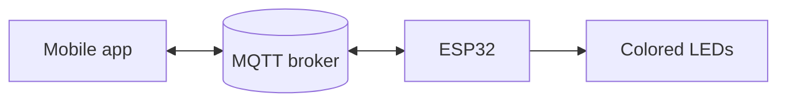

# Smart Home MQTT

A small smart-home model: a mobile app controls colored LEDs through an ESP32
over MQTT. Each LED represents a home device, and the garage scenario adds
blinking, state tracking and voice announcements.

<!-- Replace with a short GIF of the garage scenario -->


## Features
- Garage door scenario: `opening` (red LED blinks 5 s, voice) then `open` (steady red, voice), and the same on closing
- Cooler (blue), TV (green) and house door (yellow) control
- One-tap **Night mode**: closes garage and door, turns off TV and cooler
- Live device status in the app, retained across restarts
- Connection monitoring with MQTT Last Will
- Voice announcements driven by status messages, so voice and LEDs never disagree

## Architecture

Full details: [docs/architecture.md](docs/architecture.md)

## Device map

| Device | LED | Topics |
|---|---|---|
| Garage | red | `home/garage/{cmd,status}` |
| Cooler | blue | `home/cooler/{cmd,status}` |
| TV | green | `home/tv/{cmd,status}` |
| House door | yellow | `home/door/{cmd,status}` |

Complete topic and payload list: [docs/mqtt-contract.md](docs/mqtt-contract.md)

## Repository layout
```
app/        mobile app
firmware/   ESP32 firmware (PlatformIO)
broker/     local Mosquitto broker (Docker)
docs/       contract, architecture, wiring
```

## Hardware
ESP32 dev board, 4 LEDs with resistors, breadboard. See [docs/hardware-wiring.md](docs/hardware-wiring.md).

## Getting started
1. **Broker**: `cd broker && docker compose up -d`
2. **Firmware**: copy `firmware/include/config.example.h` to `config.h`, fill in Wi-Fi and broker address, then `pio run -t upload` (see [firmware/README.md](firmware/README.md))
3. **App**: see [app/README.md](app/README.md)

## Credits
- **App and MQTT integration**: [CodeBitForge](https://github.com/CodeBitForge)
- **Firmware**: [CodeBitForge](https://github.com/CodeBitForge)

## Roadmap
- [ ] App UI and MQTT client
- [ ] Voice clips
- [ ] Doorbell / intercom status (`home/bell/status`)
- [ ] TLS and broker authentication
- [ ] Scheduled automations

## License
MIT. See [LICENSE](LICENSE).
