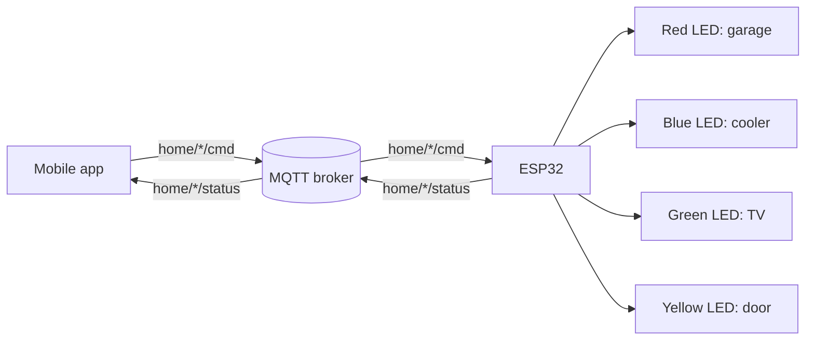
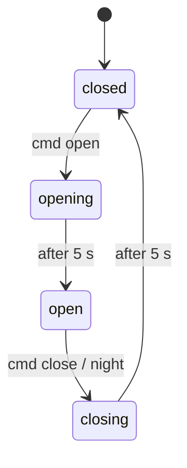

# Architecture

## Responsibilities
- **App**: sends one command, displays status, plays voice from status messages.
- **ESP32**: executes the whole scenario (blinking, timing, state machine) and reports status.
- **Broker**: relays messages and stores retained status.

Timing logic lives on the ESP32 rather than the app, so a lost connection
mid-scenario cannot leave a device in an unknown state.

## Garage state machine

